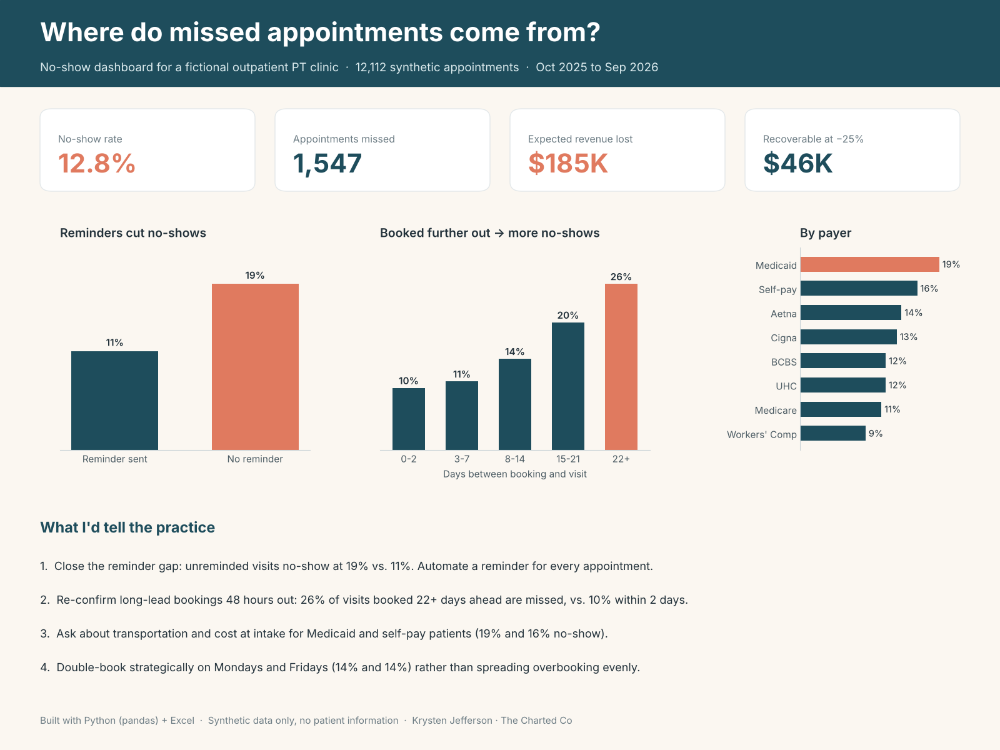
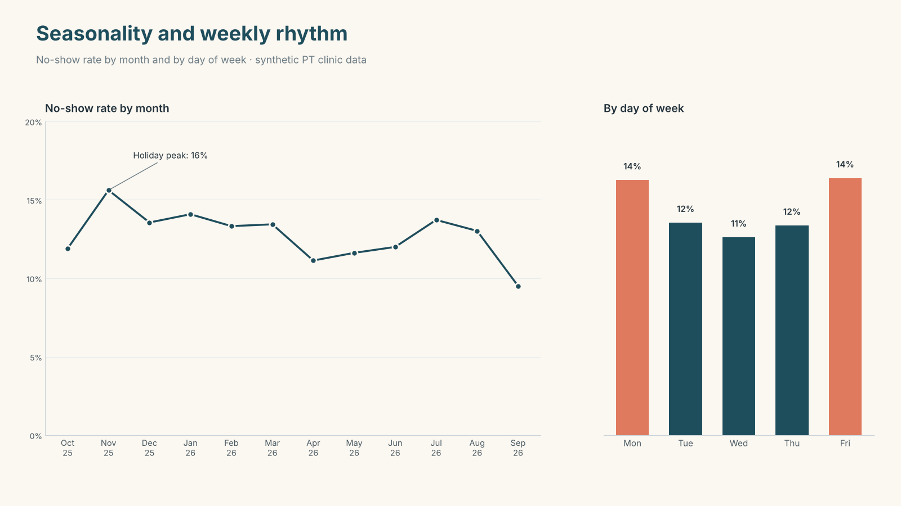

# No-Show & Scheduling Analysis for an Outpatient PT Clinic

**Where do missed appointments come from, what do they cost, and which fixes recover the most visits?**

This project analyzes a year of appointment data for a fictional 4-therapist outpatient physical therapy clinic and turns it into a working Excel dashboard plus practical recommendations for the front desk.

> **All data is synthetic.** Every patient, provider, appointment, and dollar amount was generated in Python. No real patient information was used at any point.



---

## Key findings

Across **12,112 appointments** (Oct 2025 – Sep 2026), the clinic lost **12.8%** of visits to no-shows: **1,547 missed appointments** and about **$185K** in expected revenue.

| Driver | Finding |
|---|---|
| **Reminders** | Appointments without a reminder no-show at **19%** vs. **11%** with one |
| **Booking lead time** | Visits booked 22+ days out are missed **26%** of the time vs. **10%** when booked within 2 days |
| **Day of week** | Mondays and Fridays run highest (**14%**); Wednesdays are lowest (**11%**) |
| **Payer** | Medicaid (**19%**) and self-pay (**16%**) patients no-show most; Workers' Comp least (**9%**) |
| **Seasonality** | No-shows peak in November (**16%**) around the holidays |

## Recommendations

1. **Close the reminder gap.** Automate a reminder for every appointment. This is the fastest, cheapest fix.
2. **Re-confirm long-lead bookings 48 hours out.** The risk climbs steadily the further ahead a visit is booked.
3. **Screen for barriers at intake.** Ask Medicaid and self-pay patients about transportation and cost, which are common drivers of missed visits.
4. **Overbook strategically, not evenly.** Target Mondays and Fridays instead of spreading double-booking across the week.

Cutting the no-show rate by a quarter would recover roughly **$46K** a year.



---

## What's in this repo

| File | Description |
|---|---|
| `generate_data.py` | Python script that generates the synthetic appointment dataset |
| `synthetic_pt_appointments.csv` | The generated dataset (12,112 rows) |
| `PT_NoShow_Dashboard_Portfolio.xlsx` | Interactive Excel dashboard built on the dataset |
| `images/` | Summary visuals |

## The Excel dashboard

- **Provider filter:** a drop-down at the top filters every number, table, and chart on the page.
- **Live formulas:** every value is a `COUNTIFS`/`SUMIFS` formula over the Data tab, so pasting in a new month of appointments updates the whole dashboard. Nothing is hard-coded.
- **Breakdowns:** no-show rate by month, day of week, booking lead time, reminder status, payer, referral source, time of day, provider, and visit type.
- **About tab:** project purpose, privacy approach, and a full data dictionary.

## How the data was generated

`generate_data.py` simulates about 1,500 patients, each with an episode of care (typically 2–20 visits) on a realistic weekly schedule such as Mon/Wed/Fri or Tue/Thu.

Each appointment's no-show probability comes from a logistic model whose inputs are commonly reported no-show drivers:

- **Booking lead time:** risk rises with every day between booking and the visit
- **Reminder status:** about 78% of appointments get a reminder; the rest carry higher risk
- **Day of week:** higher on Mondays and Fridays, lower midweek
- **Payer:** higher for Medicaid and self-pay, lower for Medicare and Workers' Comp
- **Time of day:** higher for late-afternoon slots, lower for early morning
- **Visit type:** initial evaluations carry more risk than follow-ups
- **Season:** a bump in November and December
- **Patient-level variation:** a random term so some patients are more reliable than others

Expected revenue uses **illustrative** per-visit rates by payer, with evaluations at 1.6×. These are not real reimbursement figures.

### Reproduce it

```bash
pip install pandas numpy
python generate_data.py
```

The random seed is fixed (`2026`), so the script should regenerate the same dataset.

## Data dictionary

| Column | Description |
|---|---|
| `appointment_id` | Unique appointment ID |
| `appointment_date` | Scheduled date |
| `weekday` | Day of week |
| `time_slot` | Scheduled start time (30-minute slots, 7:00–17:30) |
| `patient_id` | Synthetic patient ID (not a real person) |
| `provider` | Treating therapist (fictional) |
| `visit_type` | Initial evaluation, follow-up visit, re-evaluation, or discharge |
| `payer` | Primary insurance |
| `referral_source` | How the patient was referred |
| `lead_time_days` | Days between booking and the appointment |
| `reminder_sent` | Whether a reminder went out (Yes/No) |
| `status` | Completed, No-show, Late cancel, or Cancelled |
| `expected_revenue` | Illustrative expected revenue for the visit |

## Privacy approach

This project uses synthetic data only. For a real practice, the same dashboard would run **inside the practice's own Microsoft 365 or Google Workspace** on a **de-identified scheduling export** (no names, dates of birth, or medical record numbers), so no protected health information ever leaves the practice. Any work that does require access to PHI would need a Business Associate Agreement (BAA) first.

## Tools

- **Python:** pandas, NumPy
- **Excel:** COUNTIFS/SUMIFS, data validation, conditional formatting, native charts

---

## About me

I'm **Krysten **, an M.S. student in Health Informatics and Information Management student. Before data, I worked in patient intake and scheduling, patient advocacy, and health insurance, so I build tools around how practices actually work.

I build dashboards and spreadsheet automation for small healthcare practices through **The Charted Co**.

<!-- Add your links here, for example:
- Contra: https://contra.com/the_charted_co_kakikt8r?referralExperimentNid=DEFAULT_REFERRAL_PROGRAM&referrerUsername=the_charted_co_kakikt8r
- LinkedIn: https://www.linkedin.com/in/krysten-jefferson-35745a2b3/
-->
